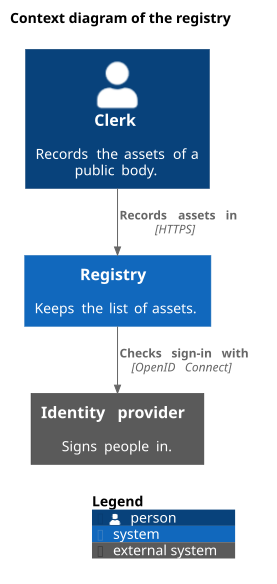

= Draw a diagram
:page-type: how-to
include::_fpsot-terms.adoc[]

This guide shows how to add a diagram to an {abbr-fpsot-first} repository and meet the diagrams specification.
It gives one small PlantUML example for each notation.

== Pick the notation

Choose the notation from the purpose of the diagram, as rule DIA-010 asks.
Use a C4 view for the architecture of systems, and {abbr-uml-first} for structure and behavior inside a system.
Use {abbr-bpmn-first} for a business process.
Generate a data model diagram from its LinkML schema, and never draw it.

== Draw an architecture view with labels in two languages

Put the layout in one file and the words in one label file per language, as DIA-042 suggests.
The layout below draws a C4 context view with the macros of the PlantUML standard library.
It also darkens the gray of external systems, since the default fails the contrast rule DIA-024.

[source,plantuml]
----
' SPDX-License-Identifier: Community-Spec-1.0
' Shared layout of the registry context diagram, used by the guide.
' The labels come from registry-context-labels-<lang>.iuml.
!include <C4/C4_Context>
UpdateElementStyle("person", $legendText=$person_type)
UpdateElementStyle("system", $legendText=$system_type)
UpdateElementStyle("external_system", $bgColor="#5A5A5A", $borderColor="#3D3D3D", $legendText=$external_type)
title $title
Person(clerk, $clerk, $clerk_desc)
System(registry, $registry, $registry_desc)
System_Ext(idp, $idp, $idp_desc)
Rel(clerk, registry, $records, "HTTPS")
Rel(registry, idp, $checks, "OpenID Connect")
SHOW_LEGEND()
----

Each label file sets the same variables in its own language.
The French file, `registry-context-labels-fr.iuml`, starts like this.

[source,plantuml]
----
' SPDX-License-Identifier: Community-Spec-1.0
' Libellés français du diagramme de contexte du registre.
!$title = "Diagramme de contexte du registre"
!$LEGEND_TITLE_TEXT = "Légende"
!$person_type = "personne"
!$clerk = "Commis"
!$clerk_desc = "Inscrit les biens d'un organisme public."
----

Each language source only names the diagram and includes its two files, as DIA-041 and DIA-042 set out.

[source,plantuml]
----
@startuml registry-context-en
' SPDX-License-Identifier: Community-Spec-1.0
' Context diagram of the registry, the C4 example of the how-to guide (DIA-011, DIA-042).
!include registry-context-labels-en.iuml
!include registry-context.iuml
@enduml
----

The page then embeds the rendered file with both text alternatives, as DIA-020 and DIA-021 ask.
Put the short text in quotes when it holds a comma.

The diagram shows three elements.

* Clerk, a person, records the assets of a public body.
* Registry, a system, keeps the list of assets.
* Identity provider, an external system, signs people in.

It shows two relationships.

* Clerk to registry: records assets in, over {abbr-https-first}.
* Registry to identity provider: checks sign-in with, over OpenID Connect.

== Draw a sequence

Use a {abbr-uml} sequence diagram for messages between parts of a system, as DIA-014 asks.
Draw it in black and white, as DIA-024 recommends.

[source,plantuml]
----
@startuml sign-in-sequence-en
' SPDX-License-Identifier: Community-Spec-1.0
' Sequence diagram of the sign-in to the registry (DIA-014).
skinparam monochrome true
title Sequence diagram of the sign-in to the registry
actor Clerk as clerk
participant Registry as registry
participant "Identity provider" as idp
clerk -> registry : Open the registry
registry -> idp : Redirect for sign-in
idp --> registry : Identity token
registry --> clerk : Home page
@enduml
----

Its long description is a numbered list of the four messages, in time order.

== Draw a business process

Draw a process as a PlantUML activity diagram, with the mapping of DIA-016.
Swimlanes stand for lanes, and `if` stands for an exclusive gateway.
The legend states the mapping.

[source,plantuml]
----
@startuml claim-review-process-en
' SPDX-License-Identifier: Community-Spec-1.0
' BPMN 2.0.2 process for the review of a claim (DIA-015, DIA-016).
skinparam monochrome true
title Process: review a claim
|Applicant|
start
:Submit the claim;
|Officer|
:Check the claim;
if (Complete?) then (yes)
  :Decide on the claim;
else (no)
  :Ask for the missing parts;
endif
stop
legend right
  BPMN 2.0.2 drawn in PlantUML
  Swimlane = lane, start and stop = none events
  Hexagon and diamond = exclusive gateway, box = task
endlegend
@enduml
----

Its long description lists the steps in order, with the lane of each step.
The gateway "Complete?" becomes a question with one sub-list for "yes" and one for "no".

== Generate a data model

Never draw a data model by hand, as DIA-018 sets.
Generate it from the LinkML schema, and commit the result in the same {term-commit} as the schema change.
Send the output to a `.iuml` file, and never use the `-d` option, which renders through an online server.

[source,shell]
----
gen-plantuml model/jurisdiction.yaml > diagrams/jurisdiction-model.iuml
----

The generator writes a {abbr-uml} class diagram, such as this excerpt.
Never edit this file by hand.

[source,plantuml]
----
class "Source" {
    {field} title : string
    {field} version : string
    {field} url : uri
    {field} archive : uri
}
"ComparisonRow" *--> "1" "Source" : "source"
----

Then write a small wrapper source for each language, as DIA-018 asks.
It gives the name, the title and the legend, and includes the generated file.
The shared workflow renders the wrapper with the pinned PlantUML.

[source,plantuml]
----
@startuml jurisdiction-model-en
' SPDX-License-Identifier: Community-Spec-1.0
' Data model of the jurisdiction files, generated from model/jurisdiction.yaml (DIA-018).
skinparam monochrome true
title Class diagram of the jurisdiction data model
!include jurisdiction-model.iuml
legend right
  Generated from model/jurisdiction.yaml with gen-plantuml
endlegend
@enduml
----

The diagram shows field names, which stay in English in both languages.
Keep one generated file with no language ending, as DIA-044 sets, and write its long description on each page.

== Render and commit

The shared diagrams workflow renders each `.puml` file with a pinned PlantUML version and its Smetana layout.
To render on your machine, use the same version.

[source,shell]
----
java -jar plantuml-1.2026.9.jar -tsvg -Playout=smetana -failfast2 diagrams/*.puml
----

Commit each {abbr-svg-first} file beside its source.
When the workflow reports a file out of date, commit the files of its `diagrams-svg` artifact.

== Document history

[cols="1,1,4",options="header"]
|===
|Version |Date |Change
|0.1.0 |2026-11-05 |First version.
|===
