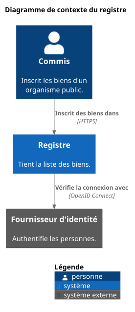

= Dessiner un diagramme
:page-type: how-to
include::_fpsot-terms.adoc[]

Ce guide montre comment ajouter un diagramme à un dépôt de la {abbr-fpsot-first} en respectant la spécification sur les diagrammes.
Il donne un petit exemple PlantUML pour chaque notation.

== Choisir la notation

Choisissez la notation selon le but du diagramme, comme le demande la règle DIA-010.
Employez une vue C4 pour l'architecture des systèmes.
Employez le {abbr-uml-first} pour la structure et le comportement internes d'un système.
Employez le {abbr-bpmn-first} pour un processus d'affaires.
Générez le diagramme d'un modèle de données à partir de son schéma LinkML, sans jamais le dessiner.

== Dessiner une vue d'architecture avec des libellés en deux langues

Mettez la disposition dans un fichier et les mots dans un fichier de libellés par langue, comme le suggère DIA-042.
La disposition ci-dessous dessine une vue de contexte C4 avec les macros de la bibliothèque standard de PlantUML.
Elle fonce aussi le gris des systèmes externes, dont la couleur par défaut ne respecte pas la règle DIA-024.

[source,plantuml]
----
' SPDX-License-Identifier: Community-Spec-1.0
' Shared layout of the registry context diagram, used by the guide.
' The labels come from registry-context-labels-<lang>.iuml.
!include <C4/C4_Context>
UpdateElementStyle("person", $legendText=$person_type)
UpdateElementStyle("system", $legendText=$system_type)
UpdateElementStyle("external_system", $bgColor="#5A5A5A", $borderColor="#3D3D3D", $legendText=$external_type)
title $title
Person(clerk, $clerk, $clerk_desc)
System(registry, $registry, $registry_desc)
System_Ext(idp, $idp, $idp_desc)
Rel(clerk, registry, $records, "HTTPS")
Rel(registry, idp, $checks, "OpenID Connect")
SHOW_LEGEND()
----

Chaque fichier de libellés fixe les mêmes variables dans sa langue.
Le fichier français, `registry-context-labels-fr.iuml`, commence ainsi.

[source,plantuml]
----
' SPDX-License-Identifier: Community-Spec-1.0
' Libellés français du diagramme de contexte du registre.
!$title = "Diagramme de contexte du registre"
!$LEGEND_TITLE_TEXT = "Légende"
!$person_type = "personne"
!$clerk = "Commis"
!$clerk_desc = "Inscrit les biens d'un organisme public."
----

Chaque source de langue nomme le diagramme et inclut ses deux fichiers, comme le prévoient DIA-041 et DIA-042.

[source,plantuml]
----
@startuml registry-context-fr
' SPDX-License-Identifier: Community-Spec-1.0
' Context diagram of the registry, the C4 example of the how-to guide (DIA-011, DIA-042).
!include registry-context-labels-fr.iuml
!include registry-context.iuml
@enduml
----

La page insère ensuite le fichier rendu avec ses deux textes de remplacement, comme le demandent DIA-020 et DIA-021.
Mettez le texte court entre guillemets droits quand il contient une virgule.

Le diagramme montre trois éléments.

* Commis, une personne, inscrit les biens d'un organisme public.
* Registre, un système, tient la liste des biens.
* Fournisseur d'identité, un système externe, authentifie les personnes.

Il montre deux relations.

* Commis vers registre : inscrit des biens dans, par {abbr-https-first}.
* Registre vers fournisseur d'identité : vérifie la connexion avec, par OpenID Connect.

== Dessiner une séquence

Employez un diagramme de séquence {abbr-uml} pour les messages entre les parties d'un système, comme le demande DIA-014.
Dessinez-le en noir et blanc, comme le recommande DIA-024.

[source,plantuml]
----
@startuml sign-in-sequence-fr
' SPDX-License-Identifier: Community-Spec-1.0
' Sequence diagram of the sign-in to the registry (DIA-014).
skinparam monochrome true
title Diagramme de séquence de la connexion au registre
actor Commis as clerk
participant Registre as registry
participant "Fournisseur d'identité" as idp
clerk -> registry : Ouvrir le registre
registry -> idp : Rediriger pour la connexion
idp --> registry : Jeton d'identité
registry --> clerk : Page d'accueil
@enduml
----

Sa description longue est une liste numérotée des quatre messages, dans l'ordre du temps.

== Dessiner un processus d'affaires

Dessinez un processus comme un diagramme d'activités PlantUML, avec la correspondance de DIA-016.
Les couloirs du diagramme représentent les couloirs du processus, et `if` représente une passerelle exclusive.
La légende indique la correspondance.

[source,plantuml]
----
@startuml claim-review-process-fr
' SPDX-License-Identifier: Community-Spec-1.0
' BPMN 2.0.2 process for the review of a claim (DIA-015, DIA-016).
skinparam monochrome true
title Processus : examiner une demande
|Clientèle|
start
:Soumettre la demande;
|Personnel de l'organisme|
:Vérifier la demande;
if (Complète?) then (oui)
  :Statuer sur la demande;
else (non)
  :Demander les pièces manquantes;
endif
stop
legend right
  BPMN 2.0.2 dessiné en PlantUML
  Couloir = couloir, début et fin = événements simples
  Hexagone et losange = passerelle exclusive, boîte = tâche
endlegend
@enduml
----

Sa description longue énumère les étapes dans l'ordre, avec le couloir de chaque étape.
La passerelle « Complète? » devient une question, avec une sous-liste pour « oui » et une pour « non ».

== Générer un modèle de données

Ne dessinez jamais un modèle de données à la main, comme le fixe DIA-018.
Générez-le à partir du schéma LinkML et archivez le résultat dans le même {term-commit} que le changement du schéma.
Envoyez la sortie dans un fichier `.iuml`.
N'employez jamais l'option `-d`, qui produit le rendu par un serveur en ligne.

[source,shell]
----
gen-plantuml model/jurisdiction.yaml > diagrams/jurisdiction-model.iuml
----

Le générateur écrit un diagramme de classes {abbr-uml}, comme cet extrait.
Ne modifiez jamais ce fichier à la main.

[source,plantuml]
----
class "Source" {
    {field} title : string
    {field} version : string
    {field} url : uri
    {field} archive : uri
}
"ComparisonRow" *--> "1" "Source" : "source"
----

Écrivez ensuite une petite source enveloppe pour chaque langue, comme le demande DIA-018.
Elle donne le nom, le titre et la légende, et inclut le fichier généré.
Le flux de travail partagé produit le rendu de l'enveloppe avec la version fixe de PlantUML.

[source,plantuml]
----
@startuml jurisdiction-model-fr
' SPDX-License-Identifier: Community-Spec-1.0
' Modèle de données des fichiers de juridictions, généré à partir de model/jurisdiction.yaml (DIA-018).
skinparam monochrome true
title Diagramme de classes du modèle de données des juridictions
!include jurisdiction-model.iuml
legend right
  Généré à partir de model/jurisdiction.yaml avec gen-plantuml
endlegend
@enduml
----

Le diagramme montre des noms de champs, qui restent en anglais dans les deux langues.
Gardez un seul fichier généré sans terminaison de langue, comme le fixe DIA-044.
Rédigez sa description longue sur chaque page.

== Produire le rendu et archiver

Le flux de travail partagé produit le rendu de chaque fichier `.puml` avec une version fixe de PlantUML.
Il emploie la mise en page Smetana.
Pour faire le rendu sur votre poste, employez la même version.

[source,shell]
----
java -jar plantuml-1.2026.9.jar -tsvg -Playout=smetana -failfast2 diagrams/*.puml
----

Archivez chaque fichier {abbr-svg-first} à côté de sa source.
Quand le flux de travail signale un fichier périmé, archivez les fichiers de son artefact `diagrams-svg`.

== Historique du document

[cols="1,1,4",options="header"]
|===
|Version |Date |Changement
|0.1.0 |2026-11-05 |Première version.
|===
